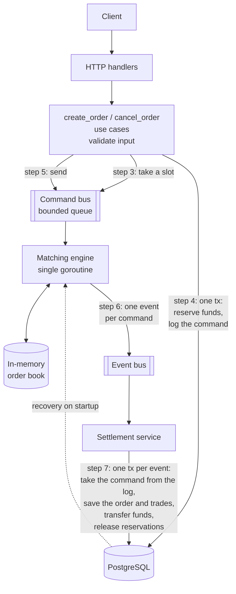

# Dixchange

[](https://github.com/Murlokich/Dixchange/actions/workflows/initial.yml)

## What it is

The backend of an exchange-style trading platform, written in Go with PostgreSQL. Users deposit
funds and place limit orders. A single-threaded in-memory matching engine matches the orders,
and a settlement service records the trades and moves the balances in the database. After a
crash the app restarts and rebuilds the order book from the database. The web UI, a React
app, is in [frontend/](frontend/) (see [frontend/README.md](frontend/README.md)); the rest
of the repository is the backend.

Stack: Go 1.26, Gin, PostgreSQL 18, pgx + sqlc, golang-migrate, google/btree,
testcontainers. Frontend: React 19, TypeScript, Vite.

## Architecture



Placing an order:

1. **HTTP handler** (`internal/controller/http`) binds the JSON body and takes the user id
   from the JWT.
2. **`create_order` use case** validates the input, converts price and quantity to scaled
   integers (see [numeric_types.md](numeric_types.md)) and works out what the order debits: a
   sell reserves the base quantity, a buy reserves the quote notional (price × quantity).
3. **Command bus slot.** Before writing anything, the use case takes a slot in the bounded
   command bus. If no slot frees up within `COMMAND_BUS_SEND_TIMEOUT` (100 ms by default),
   the request is rejected with 503 and nothing is written.
4. **One transaction** reserves the funds (400 if the balance is insufficient) and inserts a
   *place* command into the command log table.
5. **After the commit** the command is sent into the slot taken in step 3, so the send never
   blocks. The request returns 201 at this point: matching and settlement happen
   asynchronously.
6. **Matching engine** (`internal/matching_engine`) is a single goroutine that takes commands
   from the bus one at a time and applies them to the in-memory order book: the order is
   matched against the opposite side and any remainder rests in the book. It publishes
   exactly one event per command (`OrderPlaced` with its trades, `OrderCancelled` or
   `CancelRejected`) to the event bus.
7. **Settlement service** (`internal/trade/service`) consumes the events in order and
   handles each one in a single transaction. For `OrderPlaced`: delete the command from the
   log, insert the order, and for each trade record it, move the quote asset from buyer to
   seller and the base asset from seller to buyer, release the buyer's excess reservation
   (when the trade price is better than the buyer's limit) and update the filled quantity
   and status of both orders.

Cancelling goes the same way. The use case checks that the order belongs to the user and is
still active, writes a *cancel* command to the log and sends it. The engine removes the order
from the book (or publishes `CancelRejected` if it was already filled or cancelled), and settlement marks
it cancelled and releases the funds still reserved for its unfilled part. Read endpoints
(balances, orders, trades) query PostgreSQL directly; market data comes from a cache
loaded at startup.

The app runs the engine, settlement and the HTTP server in one `errgroup`: if the engine or
settlement fails, the process exits with code 1 and docker compose restarts it
(`restart: on-failure`). The order book is then rebuilt on startup, as described below.

## Order book

One book per market pair (`internal/matching_engine/order_book`):

- Each side is a B-tree of price levels ([google/btree](https://github.com/google/btree)),
  so the best bid and ask, insertion and removal of a level are O(log P) for P price levels.
- Each price level holds a FIFO queue (`container/list`) of resting orders, which gives
  price-time priority: better price first, then earlier arrival.
- A map from order id to its list node removes a cancelled order from its queue in O(1),
  without scanning the book.
- Trades execute at the resting order's price.

Why this structure over the alternatives: [order_book.md](order_book.md).

## Crash recovery

There is no in-process recovery: any error in the engine or settlement ends the process
(exit code 1) and docker compose restarts it. The order book exists only in memory, so the
restarted app rebuilds it from the database:

- **Snapshot:** the active orders (`open`, `partially_filled`) are inserted straight into the
  book, without going through the engine: they were matched when they arrived, so they can't
  produce trades, and they are already settled. They are loaded in settlement order
  (`created_at`), which keeps time priority within a price level, with their remaining
  quantity.
- **Log tail:** the commands still in the command log are then replayed through the engine
  like new commands, so they produce events and get settled. A command is deleted from the
  log in the same transaction that applies its effect, so the log holds exactly the commands
  whose effect is missing from the snapshot.

Settlement starts before the replay, and the HTTP server only after it, so no new request
gets in between replayed commands. Trades that were matched but not settled before the crash
are matched again; the result is a valid state, not necessarily the same trades. The log is
replayed in command id order, which can differ from the order concurrent requests originally
reached the engine; that doesn't affect correctness for the same reason.

## Running locally

Prerequisites: Docker (with Compose), OpenSSL, and Go 1.26 (Go is needed for the tests, not
for running the app; Node.js 24 only for frontend development).

1. Create the app's environment file `envs/app/.env` from `envs/app/.env.example`, with a
   freshly generated RSA key pair for signing the JWTs (stored as base64-encoded PEM in
   `JWT_PRIVATE_KEY_B64` and `JWT_PUBLIC_KEY_B64`). It refuses to overwrite an existing file:

   ```sh
   make env
   ```

2. Create the frontend's environment file and point it at the backend: copy
   `frontend/envs/.env.example` to `frontend/envs/.env` and set
   `VITE_BACKEND_HOST=http://localhost:8080`.

3. Start PostgreSQL, the app (migrations run on startup) and the frontend:

   ```sh
   make up
   ```

4. Check that the backend is up, then open the UI at http://localhost:5173:

   ```sh
   curl http://localhost:8080/ping   # "pong"
   ```

`make down` stops everything. The frontend's settings are built into its image, so after
changing `frontend/envs/.env` run `make rebuild-up`. The other settings (buffer sizes, Argon2 parameters, the
frontend origin allowed by CORS, ...) have defaults; see `internal/config/config.go`. The
environment files are described in [envs/README.md](envs/README.md).

## API

All request and response bodies are JSON. Endpoints marked "Auth" need the token issued by
login, in an `Authorization: Bearer <token>` header or the `access_token` cookie (see
[Auth](#auth)).

| Method | Path | Auth | Purpose |
|---|---|---|---|
| GET | `/ping` | no | Health check. |
| POST | `/api/auth/register` | no | Create a user (email, password) with empty balances. |
| POST | `/api/auth/login` | no | Check credentials and set the `access_token` cookie. |
| GET | `/api/market/pairs` | no | Market pairs with their symbols, lot size, price tick and precision. |
| POST | `/api/balance/deposit` | yes | Add an amount of a symbol to the user's balance. |
| GET | `/api/balance/:pair_id` | yes | Available and reserved balance of the pair's base and quote. |
| POST | `/api/orders` | yes | Place a limit order; 201 once accepted, matched asynchronously. |
| GET | `/api/orders?status=open,partially_filled` | yes | The user's orders with the given active statuses. |
| POST | `/api/orders/:id/cancel` | yes | Request cancellation of an order; 202, applied asynchronously. |
| GET | `/api/trades?cursor=` | yes | The user's trades, newest first, paginated by cursor. |

## Tests

- **Unit tests** need only Go and cover the order book, domain entities, use cases (with
  mocks) and HTTP mapping: `make test`.
- **End-to-end tests** (`test/e2e`, needs Docker) run the real components wired as in
  `cmd/app.go` against PostgreSQL in a container, calling the use cases directly instead of
  HTTP so they can control when the engine and settlement run: `make test-e2e`. They read
  `envs/app/.env` like the app does, so run `make env` first.

Besides the scenario tests, a randomized suite sends a random sequence of orders and cancels
from several users, simulates a crash and restart every few commands (everything in memory is
lost and rebuilt from the database), and periodically checks invariants on the settled state:
balances equal deposits plus trades, reserved funds match the active orders, filled
quantities match the trades, statuses match the filled quantities, the book isn't crossed and
no balance is negative. A failed run writes its steps to `test/e2e/out`, and its seed can be
replayed via `E2E_RANDOM_SEED`.

Details: [tests.md](tests.md).

## Auth

Login issues an RS256-signed JWT and sets it in an `HttpOnly` cookie (`access_token`).
Protected endpoints accept the token from that cookie or from an `Authorization: Bearer`
header. Passwords are hashed with Argon2id and a random salt per password.

## Docs

- [order_book.md](order_book.md): the data structures of the order book and the plan of its
  unit tests.
- [numeric_types.md](numeric_types.md): prices and quantities as scaled integers, and the
  constraints on lot size and price tick that keep every order's cost an integer.
- [tests.md](tests.md): unit and end-to-end tests, and the e2e test cases.
- [envs/README.md](envs/README.md): the environment files.
- [frontend/README.md](frontend/README.md): the web UI, its configuration and how to run it;
  design decisions in [frontend/docs/frontend-foundation.md](frontend/docs/frontend-foundation.md).
